# Guia Tècnica d'Usuari: Gestió d'Emmagatzematge amb LVM a Zorin OS

Aquesta guia detalla el procediment complet per configurar, administrar, protegir i escalar volums d'emmagatzematge mitjançant **Logical Volume Manager (LVM)** en entorns Linux basats en Ubuntu/Debian (com **Zorin OS**).

---

## Preparació de l'Entorn i Requisits

Per dur a terme aquesta implementació sobre **Zorin OS**, cal disposar d'una màquina virtual amb accés a terminal (`sudo`) i incorporar els discos virtuals necessaris des del programari de virtualització (VirtualBox o VMware).

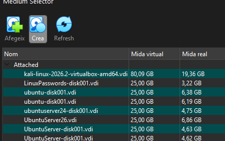


1. **Instal·lació de les utilitats LVM:**
   Obre el terminal i instal·la el paquet d'administració `lvm2`:

   ```bash
   sudo apt update && sudo apt install lvm2 -y
   ```
---
   > 💡 **Resolució d'incidències de xarxa:** Si la descàrrega falla per un error de resolució DNS (`Fallo temporal al resolver...`), assegura't que l'adaptador de xarxa de la màquina virtual estigui configurat en mode **NAT**.

---

2. **Identificació dels dispositius de bloc:**
   Abans de manipular discos, verifica quins noms els ha assignat el sistema per evitar tocar el disc principal del sistema operatiu (`/dev/sda`):

   ```bash
   lsblk
   ```

   

> 🚨 En la captura es veu 3 discos d'un 1GB cadascun, aixo es perque em vaig equivocar al principi i al tornar a fer l'activitat amb els dos discos de 10 GB s'hem va oblidar fer la captura.


---

## Fase 1: Configuració Inicial i Muntatge Persistent

En aquesta primera etapa es connecten **dos discos durs de 10 GB** (`/dev/sdb` i `/dev/sdc`) per construir la base de l'emmagatzematge i automatitzar-ne la disponibilitat en arrencar l'equip.

### 1.1. Inicialització dels Volums Físics i creació del Grup de Volums

1. Prepara els dos discos de 10 GB perquè formin part de l'ecosistema LVM:

   ```bash
   sudo pvcreate /dev/sdb /dev/sdc
   ```

   
   
2. Crea un grup de volums anomenat `vg_practica` agrupant tots dos discos (generant un espai total aproximat de 20 GB):

   ```bash
   sudo vgcreate vg_practica /dev/sdb /dev/sdc
   ```

   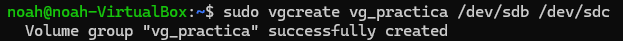

   <br>

   > 🔔 **Comprovació:** Executa `sudo vgs` per veure un resum de l'espai total i lliure del grup, o `sudo vgdisplay` si necessites inspeccionar els detalls tècnics interns (com la mida dels *Physical Extents*).

### 1.2. Creació, Formatació i Muntatge Automàtic del Volum Lògic

1. Crea un primer volum lògic de **6 GB** anomenat `lv_inicial` i dota'l d'un sistema de fitxers `ext4`:

   ```bash
   sudo lvcreate -L 6G -n lv_inicial vg_practica
   sudo mkfs.ext4 /dev/vg_practica/lv_inicial
   ```

   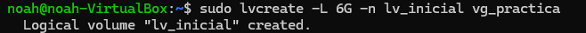

   

2. Crea el directori destí i consulta l'identificador únic (**UUID**) del nou volum:

   ```bash
   sudo mkdir -p /mnt/inicial
   sudo blkid /dev/vg_practica/lv_inicial
   ```

   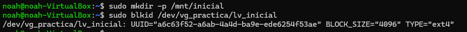

3. Per evitar haver de muntar el volum manualment després de cada reinici, edita l'arxiu `/etc/fstab` (`sudo nano /etc/fstab`) i afegeix-hi la línia següent al final (substituint el valor del teu UUID sense cometes):

   ```text
   UUID=el-teu-codi-uuid-aqui  /mnt/inicial  ext4  defaults  0  2
   ```
   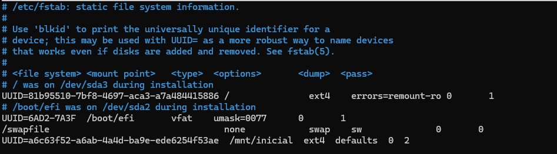

4. Aplica la configuració de muntatge immediatament i verifica que el volum està operatiu:

   ```bash
   sudo mount -av
   df -h /mnt/inicial
   ```

   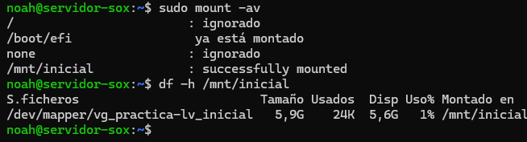

---
## Fase 2: Alta Disponibilitat mitjançant Volum Mirall (`lvm_mirror`)

Per protegir informació crítica davant la fallada física d'un disc dur, LVM permet configurar volums en mirall (equivalent a un RAID 1 per programari). Cada bloc d'escriptura es duplica simultàniament en dos dispositius físics separats.

1. **Desplegament del volum mirall:**
   Aprofitant l'espai lliure restant a `/dev/sdb` i `/dev/sdc`, crea un volum de **3.9 GB** anomenat `lvm_mirror`. El modificador `-m 1` indica al sistema que mantingui una còpia rèplica addicional:

   > (*no son 4 GB perque lvm reserva una petita part per gestió interna*)

   ```bash
   sudo lvcreate -L 3.9G -m 1 -n lvm_mirror vg_practica
   ```

   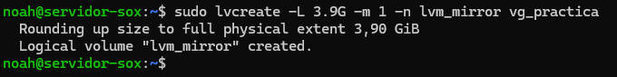

2. **Formatació, muntatge i verificació d'escriptura:**

   ```bash
   sudo mkfs.ext4 /dev/vg_practica/lvm_mirror
   sudo mkdir -p /mnt/mirror
   sudo mount /dev/vg_practica/lvm_mirror /mnt/mirror
   echo "Informacio redundant protegida contra fallades de maquinari" | sudo tee /mnt/mirror/seguretat.txt
   ```

   

   

---

## Fase 3: Instantànies (Snapshots) i Recuperació de Dades

Les instantànies capturen l'estat exacte d'un volum en un instant concret. A diferència d'una còpia tradicional, un *snapshot* es crea en segons perquè només emmagatzema els blocs que van canviant respecte a l'original (*Copy-on-Write*).

### 3.1. Incorporació de nous discos i preparació de `lvm_dades`

1. Connecta **dos nous discos de 10 GB** (`/dev/sdd` i `/dev/sde`), inicialitza'ls i incorpora'ls al grup existent:

   ```bash
   sudo pvcreate /dev/sdd /dev/sde
   sudo vgextend vg_practica /dev/sdd /dev/sde
   ```

   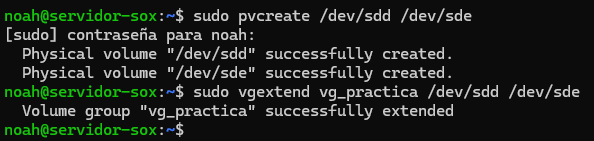

2. Crea un volum de **5 GB** anomenat `lvm_dades` ubicant-lo específicament al primer disc nou (`/dev/sdd`), formata'l i munta'l:

   ```bash
   sudo lvcreate -L 5G -n lvm_dades vg_practica /dev/sdd
   sudo mkfs.ext4 /dev/vg_practica/lvm_dades
   sudo mkdir -p /mnt/dades
   sudo mount /dev/vg_practica/lvm_dades /mnt/dades
   ```

   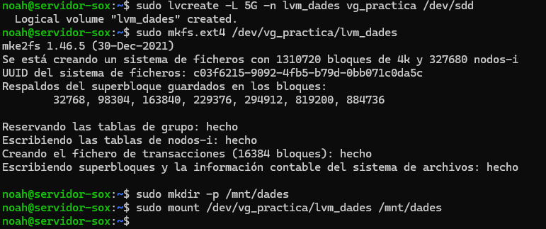

3. Desa contingut real dins el volum (per exemple, una imatge descarregada de la xarxa i un fitxer de control):

   ```bash
   ls ~/Descargas
   sudo cp ~/Descargas/nom_imatge.jpg /mnt/dades/
   echo "Fitxer integre abans de la prova" | sudo tee /mnt/dades/control.txt
   ls -lh /mnt/dades/
   ```

   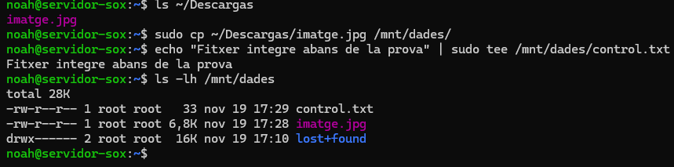

### 3.2. Creació de l'Snapshot (`lv_snapshot`)

1. Utilitza el segon disc nou (`/dev/sde`) per allotjar una instantània de **2 GB** vinculada a `lvm_dades` mitjançant l'opció `-s`:

   ```bash
    sudo lvcreate -L 2G -s -n lv_snapshot /dev/vg_practica/lvm_dades /dev/sde
   ```

   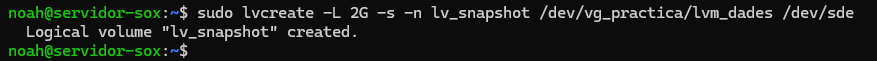

   > 🔔 **Dimensionament:** La mida d'un snapshot sol calcular-se entre un 15% i un 30% de la mida del volum origen. Si s'omple al 100% per excessives modificacions al volum original, la instantània queda invalidada.

### 3.3. Simulació de Desastre i Restauració

1. **Pèrdua simulada de dades:** Esborra tots els fitxers del directori de treball:

   ```bash
   sudo rm -rf /mnt/dades/*
   ls -la /mnt/dades
   ```

   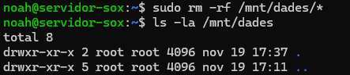

2. **Restauració des de la instantània:** Per revertir els canvis i retornar el volum al seu estat original, cal desmuntar-lo prèviament i executar l'ordre de fusió (`--merge`):

   ```bash
   sudo umount /mnt/dades
   sudo lvconvert --merge /dev/vg_practica/lv_snapshot
   sudo mount /dev/vg_practica/lvm_dades /mnt/dades
   ```

   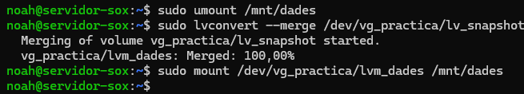

   > ❗ **Important:** En completar-se la fusió, LVM elimina automàticament el volum `lv_snapshot`, ja que el seu contingut s'ha reintegrat dins de `lvm_dades`. Comprova amb `ls -lh /mnt/dades` que tant `mostra.png` com `control.txt` s'han recuperat intactes.

---

## Fase 4: Escalabilitat i Ampliació en Calent

Quan un volum es queda sense espai lliure, LVM permet fer-lo créixer aprofitant la capacitat disponible del grup de volums sense necessitat de desmuntar el directori ni aturar l'activitat dels usuaris.

1. **Verificació de l'espai disponible al grup:**
   Consulta la columna `VFree` per assegurar-te que hi ha prou gigabytes lliures:

   ```bash
   sudo vgs
   ```

   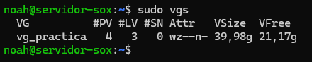

2. **Ampliació del volum i del sistema de fitxers:**
   Incrementa la capacitat de `lvm_dades` en **4 GB** addicionals (passant de 5 GB a 9 GB). L'ús del paràmetre `-r` (`--resizefs`) indica a LVM que executi automàticament l'eina `resize2fs` sobre el sistema de fitxers `ext4` de manera segura i en calent:

   ```bash
   sudo lvextend -r -L +4G /dev/vg_practica/lvm_dades
   ```

   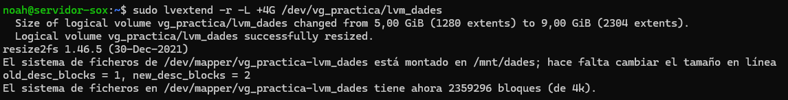

3. **Validació final:**
   Confirma que el sistema operatiu reconeix la nova mida total de 9 GB aproximadament i que els fitxers preexistents continuen accessibles:

   ```bash
   df -h /mnt/dades
   ls -lh /mnt/dades
   ```
   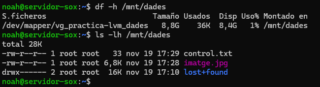
---