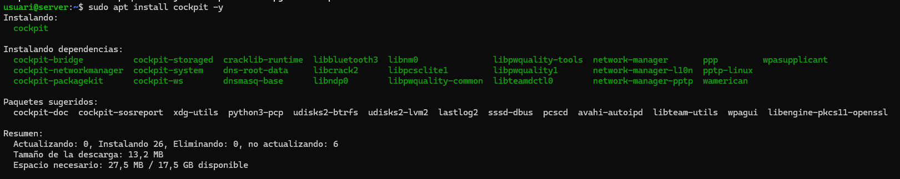
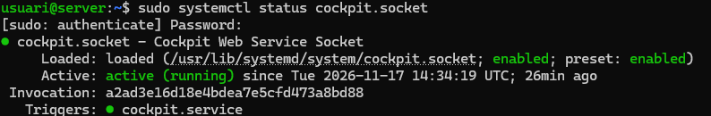
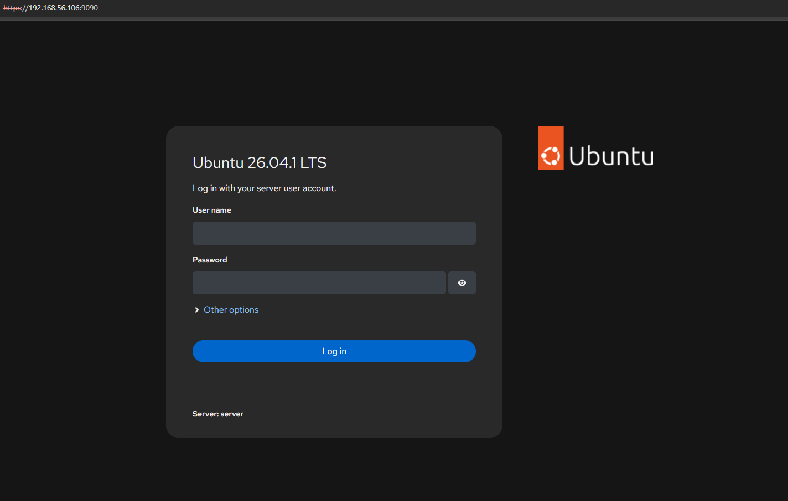
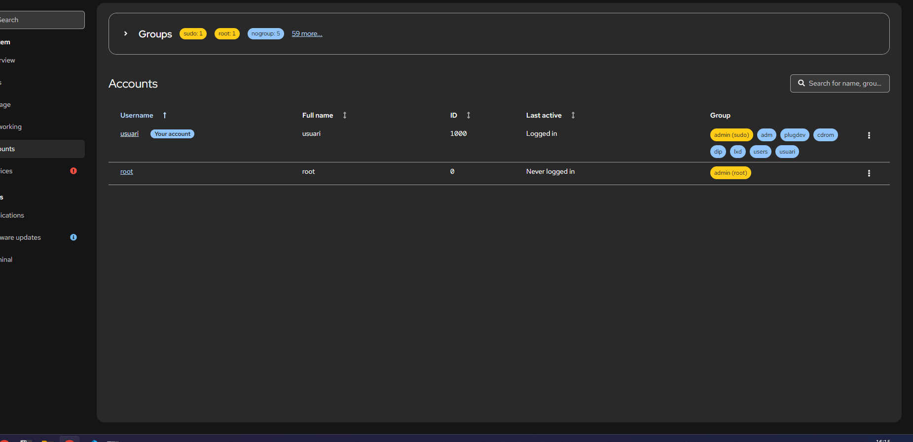
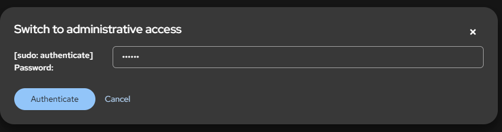
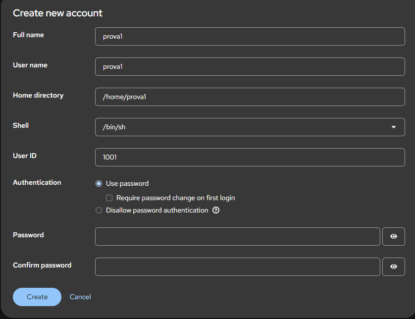
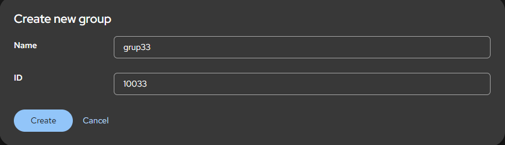
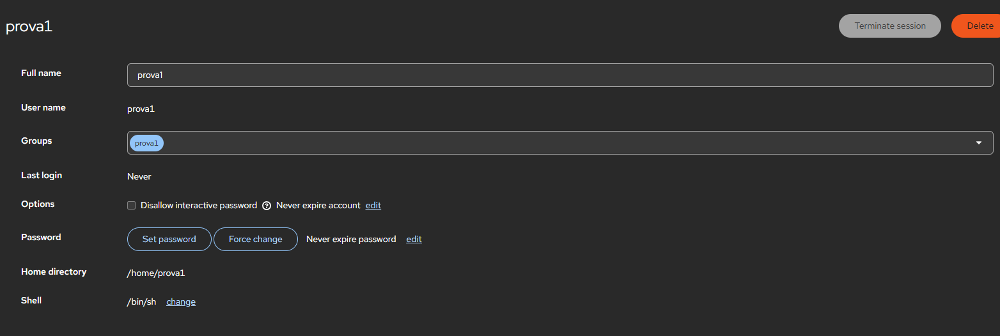
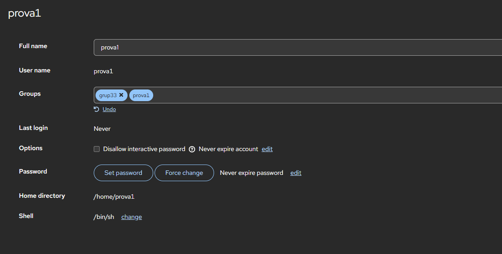

# Guia d'instal·lació i ús de Cockpit a Ubuntu Server

---

## 1. Instal·lació i posada en marxa

Per instal·lar el gestor gràfic **Cockpit** al servidor Ubuntu Server, ens hem connectat per SSH i hem executat les següents comandes des de la terminal:

```bash
# 1. Actualitzar la llista de paquets del sistema
sudo apt update -y

# 2. Instal·lar el paquet de Cockpit
sudo apt install cockpit -y
```



```bash
sudo systemctl status cockpit.socket
```


## 2. Iniciar sessió

Per iniciar sessió hem d'anar a la seguent direcció ip

```
https://<192.168.56.106>:9090
```

Surtira això quan entrem.



## 3. Prova de funcionalitats

### Menu de comptes

Al entrar surt el menu principal, en aquest cas anirem a la part de accounts per crear comptes i grups.



### Permisos d'administrador

Abans de res hem de tenir permisos, adalt a la dreta surt si tens o no.



### Creació del compte

Crearem una compte de prova, només posant el nom automaticament l'eina omple la resta d'apartats, ficarem una contrasenya basica per finalitzar la creació.



### Creació de grup

Crearem un grup, no hi han tantes opcions, li fiquem un nom i ja.



### Edició de compte

Ara, amb la compte i el grup creat, anirem a editar la compte per veure les opcions que hi han



Afegirem el grup que hem creat abans



> Una practica habitual es canviar la contrasenya del usuari, como es pot veure a la captura surt *set password* i *force change* son diferents eines per el canvi de contrasenya.